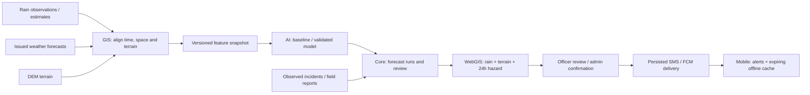

# Architecture — GeoSentry rainfall and terrain forecasting

**Version:** 2.0.0 | **Updated:** 2026-10-13 | **State:** target, not yet implemented.
[PRD](prd.md) defines the agreed next-24-hour prediction task.

## 1. Components and flow

Retain Java 17/Spring Boot Core API, two Python/FastAPI services, React WebGIS, Flutter mobile, PostgreSQL/PostGIS, Redis and Nginx. No new microservice is required for the pivot.

The AI consumes weather forecasts; it does not forecast weather. The map displays assessed hazard units, not segmentation of an observed landslide scar.

## 2. Service responsibilities

| Component | Target responsibility |
| --- | --- |
| GIS, port 8002 | Provider ingestion, source quality, DEM features, versioned spatial units and immutable as-of feature snapshots. |
| AI, port 8001 | Validate feature/model compatibility, predict for 24h, expose versioned factors and unavailable reasons; training/backtesting remains offline. |
| Core, port 3000 | Auth/RBAC, run orchestration, persist forecasts, expiry, review, incidents, subscriptions, alerts and audit. |
| WebGIS | Rainfall history/forecast charts, terrain/hazard/evidence layers, data freshness and warning review. |
| Mobile | Subscriptions, field reports, notifications, expiry-aware SQLite/geofencing; local location processing. |
| Gateway, port 8080 | Route clients; protect privileged/internal operations when auth is implemented. |
| Redis | Optional change notification/wakeup; persisted job state is the recovery source. |

Current Core writes both schemas and clients use mocks. These target responsibilities are not claims of existing enforcement.

## 3. Spatial and temporal invariants

- Prediction issue time t fixes the window [t, t+24h); all feature source records must have been available by t.
- Store provider issue time, valid interval, availability/ingestion time and source revision separately.
- Observation latency must be explicit. A gap between the most recent available observation and t is missing coverage, not dry weather.
- Use provider run IDs and valid intervals when computing forecast accumulation; do not mix forecast cycles or subtract across resets.
- All stored times use UTC. Spatial storage/interchange uses EPSG:4326; terrain derivatives/areas/distances use suitable metric coordinates or geodesic calculations.
- Retain original rainfall resolution and DEM resolution. Resampling a coarse rain grid onto a fine DEM does not create fine-resolution rainfall evidence.
- Choose assessment-unit scale after checking pilot rainfall/label support; no fixed 30m forecast accuracy claim.
- A forecast probability concerns occurrence in a unit/window. Exposure and warning priority are separate values.

## 4. Data model additions (planned migrations)

| Owner/schema | New records | Essential content |
| --- | --- | --- |
| GIS / gis_schema | assessment_units, terrain_features | Geometry/version, DEM provenance, feature schema, effective resolution. |
| GIS / gis_schema | rainfall_observations | Unit/provider, interval, available_at, ingested_at, amount/units, quality, revision. |
| GIS / gis_schema | rainfall_forecasts | Provider run/issue time, valid intervals, availability, accumulation convention and quality. |
| GIS / gis_schema | feature_snapshots | Unit/version, as-of time, source references, coverage, immutable feature values/schema. |
| Core / core_schema | forecast_runs, hazard_predictions | Window, unit/snapshot/model/threshold versions, probability or experimental score, hazard level, availability reason. |
| Core / core_schema | forecast_reviews | Authenticated reviewer, decision/reason and referenced immutable run. |
| Core / core_schema | alert_broadcasts, alert_deliveries | Existing planned alert records extended with forecast reference/window, idempotency and delivery status. |

Preserve existing users, observed landslide_events, event history, community_reports and monitoring_areas. Do not relabel old detected events as forecasts or overwrite V1/V2 migrations. Add a new migration when implementing, synchronized with the repository migration copies.

Model release metadata must identify training data, feature schema, validation report, calibration and threshold version. A forecast review is not an observed-event label.

## 5. Orchestration and failure behavior

1. A scheduled ingestion checks for new qualifying provider runs; cadence follows provider availability.
2. GIS normalizes complete supported intervals and terrain into a versioned snapshot.
3. Core persists a forecast job keyed by unit/version, issue time, model version and input snapshot; a unique constraint/idempotency key prevents duplicates.
4. AI processes the snapshot via bounded-time REST. Core persists the result before notifying clients.
5. Officer reviews; admin explicitly confirms a persisted warning request. Delivery workers process persisted tasks with bounded retries and deduplication.
6. A recovery poll finds pending jobs/tasks after restarts or lost Redis notifications. Redis Pub/Sub alone is not a durable queue.

Optional notification names: RAINFALL_INPUTS_UPDATED, HAZARD_FORECAST_READY, FORECAST_REVIEWED, COMMUNITY_REPORT_SUBMITTED, EMERGENCY_ALERT_BROADCAST. Event envelopes include eventId, schemaVersion, timestamp and referenced record IDs; consumers are idempotent. Events supplement, not replace, record retrieval.

Missing/stale input or incompatible model yields unavailable with reason. Service failure must not return fabricated low hazard or claim a task was queued when nothing was persisted. Last-known forecasts retain their original validity/quality.

## 6. API and access

[API specification](../../docs/API_SPECIFICATION.md) distinguishes existing prototype routes from planned forecast routes. New public Core routes use /api/v1/forecasts; Gateway must explicitly route them. Keep current incident APIs during migration. Do not silently replace the old scene-based inference payload with incompatible fields.

Target: admin config/broadcast, officer/admin review, citizens access published approved forecasts and their own subscriptions/reports. Internal ingestion/inference is service-authenticated and not publicly writable.

Current Docker Core sets REDIS_URL while Spring reads REDIS_HOST; fix this in the orchestration story. Existing /api/v1/core/ prefix stripping is not evidence that every route in older docs works.

## 7. Clients and expiration

- Forecast publication/review status is separate from available/unavailable quality and time-derived expiry.
- A later run can supersede an earlier run for the same unit; record this explicitly.
- Mobile sync includes run/window, geometry, publication status, supersession/revocation and last sync time.
- Cached expired predictions remain visible as stale; no fresh-risk siren based solely on an expired forecast. Offline revocations cannot be learned until reconnect.
- Confirmed incidents and active admin warnings have their own lifecycles; forecast expiration must not silently clear them.

## 8. Implementation order

Data/label feasibility → contracts and new migrations → ingestion/features → baseline/backtest → model service → persisted orchestration → WebGIS review → alert/mobile integration → held-out evaluation and failure testing. See [epics](epics.md) for acceptance criteria.
