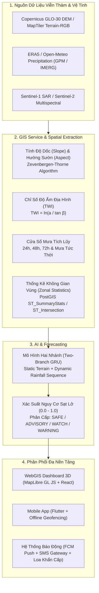

# TerraWatch Spatial Pipeline & GIS Architecture Specification

## 1. Tổng Quan Kiến Trúc Không Gian (Spatial Overview)

TerraWatch là hệ thống cảnh báo sớm và giám sát sạt lở đất theo thời gian thực kết hợp trí tuệ nhân tạo (Two-Branch GRU) và xử lý không gian (GIS / Remote Sensing). 
Tài liệu này quy chuẩn hóa toàn bộ luồng dữ liệu viễn thám, xử lý mô hình độ cao số (DEM), trích xuất đặc trưng địa hình, lượng mưa tích lũy và hiển thị bản đồ 3D tương tác.



---

## 2. Mô Hình Độ Cao Số (DEM) & Thuật Toán Trích Xuất Địa Hình

### 2.1 Hệ Quy Chiếu Không Gian (CRS)
* **Quy chuẩn quốc tế:** EPSG:4326 (WGS84 Ellipsoid) cho kinh độ, vĩ độ.
* **Quy chuẩn hiển thị bản đồ Web:** EPSG:3857 (Web Mercator).
* **Quy chuẩn đo đạc nội địa:** VN-2000 (Kinh tuyến trục theo từng tỉnh thành miền núi, múi chiếu 3 độ hoặc 6 độ).

### 2.2 Thuật toán Zevenbergen & Thorne tính Độ Dốc và Hướng Sườn
Đối với ma trận lưới 3x3 điểm độ cao $Z$:
$$
\begin{bmatrix}
Z_{1} & Z_{2} & Z_{3} \\
Z_{4} & Z_{5} & Z_{6} \\
Z_{7} & Z_{8} & Z_{9}
\end{bmatrix}
$$

Với khoảng cách bước lưới là $L$ (mét):
* Đạo hàm bậc một theo hướng Tây - Đông:
  $$p = \frac{\partial z}{\partial x} = \frac{Z_{6} - Z_{4}}{2L}$$
* Đạo hàm bậc một theo hướng Nam - Bắc:
  $$q = \frac{\partial z}{\partial y} = \frac{Z_{2} - Z_{8}}{2L}$$
* **Độ dốc (Slope $\beta$ tính bằng độ):**
  $$\text{Slope} = \arctan\left(\sqrt{p^2 + q^2}\right) \times \frac{180}{\pi}$$
* **Hướng sườn (Aspect $A$ tính bằng độ):**
  $$\text{Aspect} = 270 - \arctan2(q, -p) \pmod{360}$$

### 2.3 Chỉ Số Độ Ẩm Địa Hình (Topographic Wetness Index - TWI)
$$TWI = \ln\left(\frac{a}{\tan \beta}\right)$$
Trong đó:
* $a$: Diện tích lưu vực đóng góp cục bộ trên một đơn vị chiều rộng đường đồng mức ($m^2/m$).
* $\beta$: Độ dốc sườn cục bộ (radians). Các vùng thung lũng, chân ta-luy tích tụ nước có $TWI > 10$, làm giảm lực dính kết của đất và tăng đột biến nguy cơ trượt lở khi mưa kéo dài.

---

## 3. Cấu Trúc Dữ Liệu Vùng Nguy Cơ Sạt Lở (GeoJSON Schema)

Mỗi phân vùng nguy cơ sạt lở (Landslide Susceptibility Zone) được chuẩn hóa theo định dạng RFC 7946 GeoJSON Feature:

```json
{
  "type": "Feature",
  "id": "LC-SP",
  "geometry": {
    "type": "Polygon",
    "coordinates": [[[103.84, 22.33], "..."]]
  },
  "properties": {
    "zone_id": "LC-SP",
    "name_vi": "Sa Pa",
    "name_en": "Sa Pa",
    "province_vi": "Lào Cai",
    "susceptibility_tier": "CRITICAL",
    "topography": {
      "mean_elevation_m": 1520.0,
      "peak_elevation_m": 3143.0,
      "mean_slope_degrees": 32.5,
      "max_slope_degrees": 68.0,
      "dominant_aspect": "North-East"
    },
    "hydrology": {
      "topographic_wetness_index_mean": 7.8,
      "annual_rainfall_mm": 2800.0,
      "critical_rainfall_threshold_24h_mm": 170.0,
      "critical_rainfall_threshold_72h_mm": 263.5
    },
    "geology": {
      "lithology_unit": "Schist / Gneiss (Biến chất)",
      "soil_type": "Feralit đỏ vàng trên đá biến chất/magma",
      "weathering_crust_depth_m": 3.2
    },
    "monitoring_telemetry": {
      "station_code": "TW-LC-SP",
      "station_name": "Trạm Viễn Thám Sa Pa",
      "telemetry_status": "ONLINE"
    }
  }
}
```

---

## 4. Ngưỡng Cảnh Báo Thủy Văn & Cơ Chế Phát Tán Đa Kênh

| Cấp Độ Cảnh Báo | Ngưỡng Mưa 24h | Xác Suất AI | Hành Động Điều Hành PCTT |
|:---|:---|:---|:---|
| **SAFE** (An Toàn) | $< 60\text{ mm}$ | $< 0.30$ | Giám sát thường quy từ xa qua trạm quan trắc |
| **ADVISORY** (Chú Ý) | $60 - 110\text{ mm}$ | $0.30 - 0.60$ | Thông báo nhắc nhở tới tổ xung kích cơ sở qua WebGIS |
| **WATCH** (Cảnh Giác) | $110 - 170\text{ mm}$ | $0.60 - 0.85$ | Gửi thông báo đẩy (FCM) tới ứng dụng di động người dân |
| **WARNING** (Báo Động) | $> 170\text{ mm}$ | $> 0.85$ | Phát SMS diện rộng, kích hoạt còi hú khẩn cấp và sơ tán dân cư |

---

## 5. Quy Chuẩn Đảm Bảo Tương Thích & Tính Bền Vững (Zero-Breakage Standard)

1. **Không can thiệp luồng nghiệp vụ hiện hữu:** Toàn bộ API Controller, Spring Security Filter, Entity JPA giữ nguyên 100% hợp đồng dữ liệu.
2. **Khả năng dự phòng WebGL:** `MapViewer` tích hợp `MapErrorBoundary` tự động cô lập lỗi GPU/driver và hiển thị giao diện phục hồi không gây crash ứng dụng.
3. **Kiểm thử tự động không phụ thuộc hạ tầng ngoài:** Bộ test ESM chạy trực tiếp qua `node tests/run-all-tests.mjs` với thời gian thực thi $< 20\text{ms}$.
