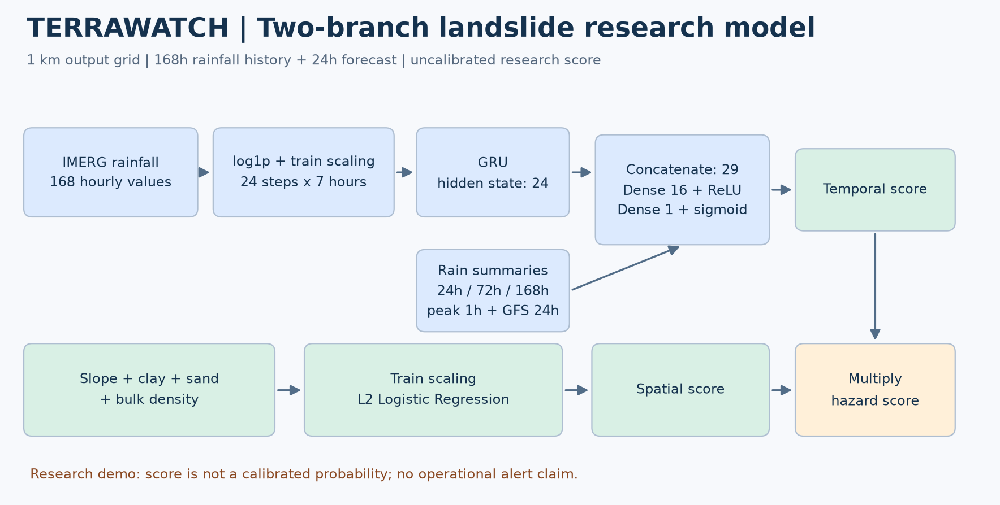
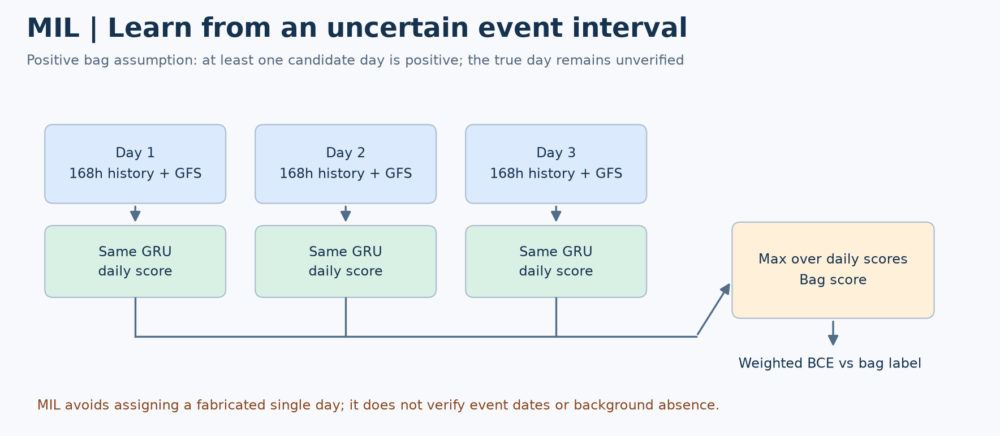
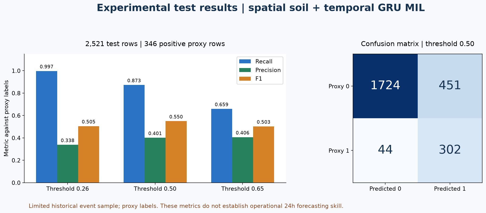

# Kịch bản thuyết trình mô hình sạt lở TerraWatch

**Thời lượng:** khoảng 8–10 phút, sau đó demo 2 phút.
**Phiên bản:** mô hình nghiên cứu Two-Branch GRU–MIL, lưới 1 km.
**Thông điệp chính:** kết hợp nơi dễ sạt với điều kiện mưa kích hoạt; đã train và đánh giá hồi cứu bằng nhãn proxy, chưa xác nhận hiệu quả cảnh báo ngoài thực tế.

Các hình PNG dưới đây hiển thị trực tiếp trên GitHub. Bản SVG cùng tên trong `assets/` dùng để phóng lớn hoặc đưa vào slide. Số liệu lấy từ [metrics.json](outputs/metrics.json), không phải số liệu dự báo trực tiếp hiện tại.

## 1. Mở đầu — bài toán cần giải quyết (45 giây)

**Nội dung trình chiếu**

- Đầu ra mong muốn: điểm nguy cơ sạt lở cho từng ô 1 km trong 24 giờ tiếp theo.
- Đầu vào: lịch sử mưa, dự báo mưa, độ dốc và đặc tính đất.
- Phạm vi chứng minh hiện tại: một số khu vực/sự kiện lịch sử ở Việt Nam.

**Lời thuyết trình**

> Thưa thầy cô và anh chị mentor, bài toán của nhóm là ước lượng nguy cơ sạt lở trong ngày tiếp theo cho từng ô lưới 1 km. Mưa lớn có thể kích hoạt sạt lở, nhưng cùng một trận mưa thì các sườn dốc và loại đất khác nhau có mức nhạy cảm khác nhau. Vì vậy, nhóm xây dựng mô hình hai nhánh: một nhánh học điều kiện không gian và một nhánh học điều kiện mưa theo thời gian. Phiên bản em trình bày là mô hình nghiên cứu đã chạy trên dữ liệu lịch sử, chưa phải hệ thống cảnh báo được xác nhận để sử dụng thực tế.

## 2. Dữ liệu thực sự đưa vào mô hình (1 phút)

| Nhóm | Biến đưa vào cấu hình slope + soil | Vai trò |
|---|---|---|
| Mưa quan trắc | 168 giá trị IMERG theo giờ trước giờ phát hành | Lịch sử mưa, tích lũy và cường độ |
| Mưa dự báo | GFS tích lũy đúng khoảng 24 giờ mục tiêu | Điều kiện mưa dự kiến tiếp theo |
| Địa hình | Độ dốc trung bình ô, đơn vị độ | Đặc tính địa hình |
| Đất | Sét %, cát %, khối lượng thể tích g/cm³ | Đặc tính vật lý đất theo nguồn |
| Nhãn | Điểm khởi phát trong kiểm kê và ô nền được chọn | Giám sát yếu, chưa là nhãn ngày xác minh đầy đủ |

**Điểm cần nói chính xác:** dữ liệu độ cao đã có trong dự án, nhưng **cấu hình đang báo cáo chỉ dùng độ dốc và ba biến đất cho nhánh không gian**, không trực tiếp dùng độ cao. Chưa dùng độ kết dính, góc ma sát hoặc áp lực nước lỗ rỗng. Ô 1 km là đơn vị đầu ra; không có nghĩa IMERG/GFS có độ phân giải gốc 1 km.

**Lời thuyết trình**

> Mỗi mẫu đầu vào gắn với một ô và một ngày mục tiêu. Nhánh thời gian nhận mưa 168 giờ trước mốc dự báo và lượng mưa GFS của 24 giờ tiếp theo. Ngày được căn theo giờ Việt Nam, từ 0 giờ đến 0 giờ hôm sau. Nhánh không gian dùng độ dốc, tỷ lệ sét, tỷ lệ cát và khối lượng thể tích đất. Các nguồn được ghép lên cùng lưới nghiên cứu. Việc ghép lưới không làm tăng độ chi tiết thực của dữ liệu mưa. Ngoài ra, thời gian quan trắc hay khởi tạo dự báo chưa tự chứng minh sản phẩm đã có sẵn trước lúc phát hành; đây vẫn là giới hạn cần kiểm chứng.

## 3. Sơ đồ kiến trúc hai nhánh (1 phút 15 giây)



**Lời thuyết trình**

> Ở phía trên là nhánh thời gian. Chuỗi mưa 168 giờ được biến đổi log và chuẩn hóa bằng thống kê tập train, sau đó chia thành 24 bước, mỗi bước gồm 7 giờ liên tiếp. GRU có 24 chiều trạng thái ẩn, dùng trạng thái cuối để tóm tắt lịch sử mưa. Trạng thái này được ghép với năm biến tổng hợp: mưa 24 giờ, 72 giờ, 168 giờ, đỉnh mưa một giờ và mưa GFS 24 giờ. Một mạng nhỏ xuất điểm kích hoạt theo thời gian.
>
> Nhánh còn lại là Logistic Regression có điều chuẩn L2, học mức nhạy cảm không gian từ độ dốc và đất. Hai điểm đầu ra được nhân với nhau để tạo điểm nguy cơ. Đây là mô hình lai: nhánh thời gian là deep learning, nhánh không gian là mô hình thống kê. Tích hai điểm chưa được hiệu chỉnh thành xác suất xảy ra sạt lở ngoài thực tế.

### Thuật toán GRU và Logistic Regression

Với mỗi bước (t), GRU tính cổng cập nhật (z_t), cổng đặt lại (r_t), trạng thái ứng viên và trạng thái mới:

$$z_t=\sigma(W_zx_t+U_zh_{t-1}+b_z),\qquad r_t=\sigma(W_rx_t+U_rh_{t-1}+b_r)$$
$$\widetilde h_t=\tanh(W_hx_t+b_{ih}+r_t\odot(U_hh_{t-1}+b_{hh}))$$
$$h_t=(1-z_t)\odot\widetilde h_t+z_t\odot h_{t-1}$$

Đây là biểu diễn theo quy ước GRU của PyTorch. Trạng thái cuối và năm biến tổng hợp đi qua `Linear(29,16) → ReLU → Linear(16,1) → sigmoid`.

Nhánh không gian:

$$s_{spatial}(u)=\sigma\left(w^\top\frac{x_u-\mu_{train}}{\sigma_{train}}+b\right)$$

Điểm ghép:

$$s_{hazard}(u,d)=s_{temporal}(u,d)\times s_{spatial}(u)$$

**Giải thích ngắn nếu mentor hỏi:** GRU học cách kết hợp lịch sử mưa thông qua trạng thái và các cổng. Nó không được cung cấp một quy luật vật lý bảo đảm sạt lở; quan hệ học được phụ thuộc nhãn, mẫu và cách đánh giá.

## 4. MIL xử lý sự kiện nhiều ngày như thế nào? (1 phút 15 giây)



**Vấn đề:** có kiểm kê được gán cho một khoảng nhiều ngày, nhưng chưa biết chính xác ngày xảy ra tại mỗi ô.

**Lời thuyết trình**

> Nếu chọn ngày mưa lớn nhất làm nhãn, nhóm sẽ tự tạo ra một ngày xảy ra chưa có bằng chứng. Thay vào đó, nhóm dùng Multiple-Instance Learning, viết tắt là MIL. Các ngày ứng viên của cùng một ô trong khoảng sự kiện được gom thành một túi. Với túi dương, giả định là có ít nhất một ngày mang tín hiệu dương. Mô hình tính điểm từng ngày rồi lấy điểm lớn nhất để tối ưu nhãn của cả túi. Cách này không gán cứng ngày xảy ra cho từng dòng. Tuy nhiên, MIL không tự xác minh giả định rằng điểm sạt thực sự thuộc đúng khoảng thời gian nguồn; nó cũng không chứng minh ngày có điểm lớn nhất là ngày xảy ra thật.

$$s_{bag}(B_i)=\max_{d\in B_i}s_{temporal}(u_i,d)$$
$$\mathcal L=\frac1N\sum_i w_i\,\operatorname{BCE}(Y_i,s_{bag}(B_i))$$

- **BCE:** phạt sai lệch giữa nhãn túi và điểm dự đoán túi.
- **Trọng số lớp:** cân bằng đóng góp của túi dương/âm; không phải hiệu chỉnh xác suất theo tần suất thực tế.
- **Trọng số Tier B dương nhiều ngày:** nhân 0,75 trong mã hiện tại; các tier khác nhân 1.
- **Bộ tối ưu:** AdamW, learning rate 0,008; weight decay 0,001; 80 epoch; seed 42.
- **Max-pooling:** gradient đi qua ngày có logit lớn nhất trong túi; không đồng nghĩa đã tìm đúng ngày sạt lở.
- Nhánh temporal Tier A học cờ cửa sổ đợt mưa; các túi âm ngoài đợt mưa cũng là nhãn giả định. Do đó nhánh này hiện gần với học điều kiện kích hoạt theo kiểm kê, chưa phải bộ phát hiện ngày sạt lở được xác minh.

## 5. Quy mô train và cách chia tập (1 phút)

| Thành phần | Quy mô |
|---|---:|
| Spatial train, 12 huyện giai đoạn 2017–2018 | 7.060 ô: 2.016 có điểm và 5.044 ô nền |
| Túi MIL dương nhiều ngày | 2.104 túi, 6.128 dòng ô/ngày |
| Túi âm bổ sung | 432 túi đơn ngày giả định |
| Tier A Phong Thổ | 116 túi đơn ngày |
| Tổng temporal train | 2.652 túi, 6.676 dòng ô/ngày |
| Validation Nha Trang | 56 dòng: 38 dương, 18 âm proxy; ba ngày lịch gồm ngày sự kiện và hai ngày nền |
| Test Phong Điền + Hướng Hóa | 2.521 dòng: 346 dương, 2.175 âm proxy; bốn ngày lịch |

**Lời thuyết trình**

> Nhánh không gian học từ 12 huyện trước giai đoạn validation. Nhánh GRU học từ 2.652 túi. Validation nằm ở Nha Trang năm 2018, còn test nằm ở Phong Điền và Hướng Hóa năm 2020. Hai ngày sự kiện tháng 10/2020 được giữ cùng tập, tránh đưa lịch sử mưa chồng lấn vào các tập khác nhau. Số lượng ô khá lớn, nhưng số đợt độc lập vẫn ít; hàng nghìn dòng không tương đương hàng nghìn trận mưa độc lập. Tập test này đã được dùng so sánh nhiều cấu hình, nên lần cải tiến tiếp theo cần thêm tập giữ lại mới để đánh giá xác nhận.

## 6. Kết quả và cách đọc đúng (1 phút 30 giây)



Kết quả **Option B, slope + soil**, trên 2.521 dòng test, đối chiếu nhãn proxy:

| Ngưỡng thử | TP | FP | FN | Recall | Precision | F1 |
|---|---:|---:|---:|---:|---:|---:|
| 0,26 — chọn F1 trên validation | 345 | 675 | 1 | 99,71% | 33,82% | 0,5051 |
| 0,50 — ngưỡng tham chiếu | 302 | 451 | 44 | 87,28% | 40,11% | 0,5496 |
| 0,65 — ngưỡng tham chiếu cao | 228 | 333 | 118 | 65,90% | 40,64% | 0,5028 |

- **TP:** ô dương được phát hiện; **FP:** ô nền bị báo dương; **FN:** ô dương bị bỏ sót, theo nhãn proxy.
- ROC-AUC toàn tập: **0,8702**; riêng các dòng ngày sự kiện: **0,6121**.
- Trong hai ngày nền được chọn của test, không có dòng báo dương ở ngưỡng 0,50. Không được suy rộng thành “không báo động giả ngoài thực tế”.
- Tăng ngưỡng 0,50 → 0,65 giảm số cảnh báo nhưng precision tăng rất ít, đồng thời bỏ sót nhiều hơn. Chưa có ngưỡng vận hành được xác nhận.

**Lời thuyết trình**

> Tại ngưỡng 0,5, mô hình phát hiện 302 trong 346 ô dương, tương đương recall 87,28%. Đổi lại có 451 ô nền được báo dương, nên precision chỉ 40,11%. Điều này cho thấy mô hình nhạy với các ô dương trong bộ dữ liệu, nhưng vẫn báo rộng. ROC-AUC toàn tập là 0,8702; khi chỉ so sánh các ô trong ngày sự kiện thì còn 0,6121, vì bài toán phân biệt nơi có và không có điểm sạt trong cùng điều kiện mưa khó hơn. Nhóm không diễn giải AUC thành phần trăm độ chính xác và cũng không coi điểm 0,8 là xác suất sạt lở 80%.

## 7. Kịch bản thao tác demo app (2 phút)

1. Mở màn hình bản đồ, chọn **chế độ dữ liệu lịch sử**.
2. Chọn **Phong Điền, 12/10/2020** hoặc **Hướng Hóa, 18/10/2020**; chỉ dùng khu vực/ngày có dòng trong bảng dự đoán.
3. Chọn một ô 1 km, hiển thị độ dốc, thành phần đất, mưa 168 giờ và GFS 24 giờ mục tiêu.
4. Hiển thị riêng điểm temporal, spatial và điểm ghép. Thang màu ghi **điểm nguy cơ mô hình**, không ghi “xác suất sạt lở”.
5. Bật lớp điểm kiểm kê để đối chiếu. Minh họa cả một ô đúng và một ô báo dương nhầm để giải thích giới hạn.
6. Nếu cho đổi ngưỡng, chú thích là **ngưỡng thử nghiệm** và hiển thị đánh đổi phát hiện/báo rộng.

**Lời thuyết trình**

> Đây là bản phát lại một ngày lịch sử, không phải dự báo thời tiết hiện tại. Với mỗi ô, ứng dụng hiển thị đầu vào và điểm của hai nhánh. Khi bật lớp kiểm kê, thầy cô có thể xem nơi mô hình trùng điểm đã ghi nhận và nơi báo dương nhưng không có điểm trong kiểm kê. Ở bản demo này, nhóm có thể nạp bảng dự đoán đã tính sẵn để bảo đảm buổi trình bày ổn định; nếu chạy suy luận trực tiếp thì đó là cùng mô hình được nạp từ checkpoint, không phải train lại trong app.

**Nhãn giao diện đề nghị:** “Mô hình thử nghiệm nghiên cứu; dữ liệu lịch sử; chưa dùng để cảnh báo an toàn thực tế.” Nếu app chưa tích hợp, không trình bày các bước trên như chức năng đã hoàn thành.

## 8. Kết luận trình bày (30 giây)

> Đóng góp hiện tại của nhóm là ghép dữ liệu trên lưới cố định, xây mô hình hai nhánh và dùng MIL để học từ nhãn có khoảng thời gian bất định. Nhóm đã train, lưu checkpoint và xuất bảng dự đoán phục vụ demo. Hạn chế chính là nhãn proxy, số sự kiện độc lập còn ít, thời điểm sẵn có của đầu vào lịch sử chưa được chứng minh đầy đủ và tỷ lệ cảnh báo nhầm còn cao. Vì vậy, kết quả hiện tại chứng minh khả năng xây dựng và chạy mô hình nghiên cứu; chưa chứng minh một hệ thống cảnh báo sạt lở 24 giờ đã sẵn sàng vận hành.

## 9. Câu hỏi mentor có thể hỏi

**Đây có phải mô hình deep learning không?**
Có ở nhánh GRU; toàn bộ hệ thống là mô hình lai GRU và Logistic Regression, không phải cả hai nhánh đều là mạng sâu.

**Tại sao cần hai nhánh?**
Nhánh temporal học điều kiện mưa, spatial học sự khác biệt địa hình/đất. Các thí nghiệm trên tập hiện có gợi ý cách tách này hữu ích, nhưng chưa chứng minh ưu thế trên mọi vùng.

**Có dùng độ cao không?**
Dự án có độ cao; cấu hình slope + soil đang báo cáo không dùng trực tiếp biến độ cao.

**Tại sao không chọn ngày mưa lớn nhất?**
Không có bằng chứng mọi điểm sạt xảy ra đúng ngày đó. Chọn ngày bằng mưa của cả đợt còn có thể dùng thông tin tương lai. MIL giữ nhãn ở cấp khoảng sự kiện.

**Ô không có điểm có chắc là không sạt không?**
Không. Đó là nền proxy trong footprint và được lọc cách các điểm đã ghi nhận trên 1 km; vẫn có khả năng bỏ sót hoặc trượt chảy đi qua.

**87,28% có phải độ chính xác toàn mô hình không?**
Không. Đó là recall trên ô dương proxy tại ngưỡng 0,50. Precision tương ứng là 40,11%; phải trình bày cả hai.

**MIL có tìm ra ngày xảy ra chính xác không?**
Không có bảo đảm. Điểm ngày là kết quả học với giám sát cấp túi; cần nhãn ngày độc lập để kiểm định khả năng định thời.

**Mô hình đã chạy GPU chưa?**
Mã huấn luyện có tùy chọn CUDA. Kết quả checkpoint đang báo cáo được tạo bằng CPU (`torch 2.15.0+cpu`), 80 epoch, seed 42.

**Có triển khai cảnh báo toàn quốc ngay không?**
Chưa. Chưa kiểm chứng trên chuỗi thời gian liên tục và vùng mới đủ rộng; chưa hiệu chỉnh xác suất; chưa xác nhận dữ liệu đầu vào thực sự có sẵn tại giờ phát hành lịch sử.

## 10. Tệp bàn giao và nguồn

- Checkpoint: [outputs/two_branch_gru_1km.pt](outputs/two_branch_gru_1km.pt).
- Bảng demo: [test_predictions_2521.csv](outputs/test_predictions_2521.csv), [validation_predictions_56.csv](outputs/validation_predictions_56.csv).
- Bộ nạp hai nhánh không phụ thuộc mã train: [inference_demo.py](inference_demo.py).
- Chỉ số: [metrics.json](outputs/metrics.json). Tệp checkpoint hiện lưu hệ số spatial làm tròn 4 chữ số; đầu ra nạp lại có sai lệch nhỏ so với bản đánh giá dùng hệ số đầy đủ. Xem `verification.json` cho phép đo thực tế.
- Lịch sử huấn luyện: [history.json](outputs/history.json).
- Kiểm kê nguồn: [Lower Mekong landslide inventory](https://doi.org/10.6084/m9.figshare.14199227), [bài mô tả phương pháp](https://doi.org/10.1002/gdj3.145).
- Tài liệu tham khảo ngoài: [repo vietnam-gru của tác giả](https://github.com/spacekatze/vietnam-gru). Đây là mô hình lưới mới của dự án; không tuyên bố đã tái lập chính xác mô hình đơn vị sườn dốc của tác giả.

### Chạy suy luận từ CSV đã chuẩn bị

```bash
python inference_demo.py --input input_features.csv --output demo_scores.csv
```

CSV cần `rain_h001` đến `rain_h168` theo thứ tự cũ → mới, `forecast_24h_mm`, `slope_deg`, `clay_pct`, `sand_pct`, `bulk_density_g_cm3`. Mưa dùng mm theo giờ và tổng mm/24 giờ; độ dốc dùng độ; sét/cát dùng phần trăm; khối lượng thể tích dùng g/cm³. Không truyền mưa sau giờ phát hành vào lịch sử 168 giờ. Loader yêu cầu số hữu hạn và không tự điền dữ liệu thiếu. Các bảng dự đoán demo không có đủ 168 cột mưa để dùng trực tiếp làm input loader.
